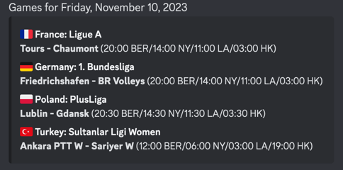

# Serve

Get the schedule your favourite volleyball leagues straight to your discord channel of choice.

The outcome looks as such:



## Deployment

```bash
brew install flyctl

flyctl auth login

fly launch

# set env variables
fly secrets set FLASHSCORE_API_KEY=<flashscore-api-key>
fly secrets set DISCORD_URI=<full-discord-uri>

# run only one container to execute CRON only once
fly scale count 1

# update running app
fly deploy
```

## Testing

`go test ./serve/...` runs:

- a single end-to-end test (`serve/app_test.go`) against fake Flashscore and Discord servers
- in-memory tests for match filtering and Flashscore response parsing

## TODOs

- use `"NAME_PART_1"` & `"NAME_PART_2"` from flashscore response for country/league struct
- Add Emojis to high set scores
